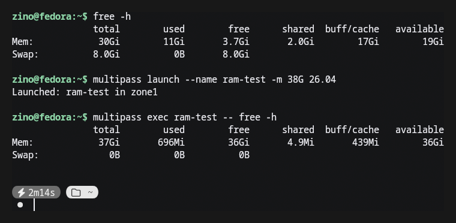
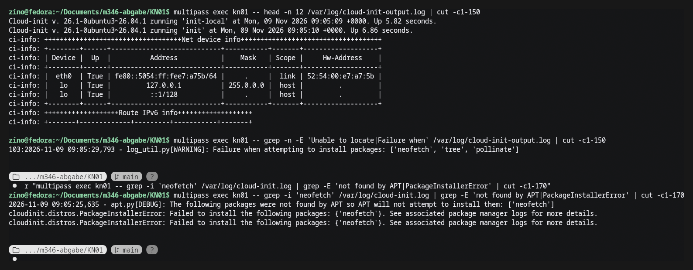
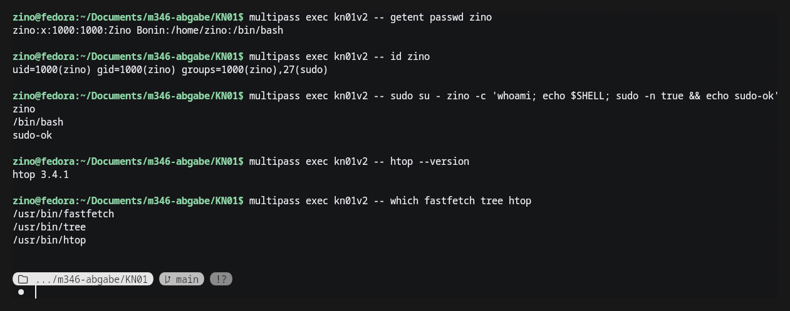

# KN01: Virtualisierung & erste automatisierte VM

**Host-System:** Fedora Linux 44, Intel Core i7-1355U (10 Kerne / 12 logische Prozessoren), 30 GiB RAM, 8 GiB Swap (zram)
**Multipass:** 1.17.0 · **Backend:** `qemu` (QEMU/KVM)

> Abschnitte mit ✏️ muss ich noch selbst in eigenen Worten ausformulieren.

---

## A) Repository & Multipass-Test

### A1) Abgabe-Repository

- Repository: <https://github.com/zinoos/m346-abgabe> (privat) · ✏️ Lehrperson mit Leserechten berechtigen
- Struktur: ein Ordner pro Kompetenz (`KN01/` … `KN09/`) mit je einer `README.md`, Screenshots in `KNxx/img/`, Code immer als eigene Datei.

### A2) Multipass installieren und Test-VM

Installation auf Fedora über Snap (`snapd` + `snap install multipass`).


Die Test-VM `smoke` (1 CPU, 1 GB RAM, 5 GB Disk, Ubuntu 26.04) lief und wurde danach mit `multipass delete --purge smoke` wieder gelöscht.

### A3) Aufgetretene Probleme und Lösungen

Auf Fedora lief Multipass nicht auf Anhieb. Zwei Probleme, beide nicht in der A3-Tabelle (die ist auf Windows ausgerichtet):

| Symptom | Ursache | Lösung |
|---|---|---|
| `launch` hängt bei «Starting» und bricht nach 15 min mit «Timed out waiting for instance launch» ab. VM hat keine IPv4-Adresse. | Die Fedora-Firewall (firewalld) ordnet die Multipass-Bridge `mpqemubrzone1` der Standardzone zu, die nur Ports ab 1025 erlaubt. Die DHCP-Anfrage der VM (UDP-Port 67) wird blockiert. | Bridges der Zone `trusted` zuweisen: `sudo firewall-cmd --permanent --zone=trusted --add-interface=mpqemubrzone1 …` und `sudo firewall-cmd --reload` |
| VM startet, aber cloud-init kann keine Pakete installieren (`Network is unreachable` im Log). Gateway und DNS funktionieren, Internet nicht. | Docker ist ebenfalls installiert und setzt die Forwarding-Policy des Kernels auf `DROP`. Damit wird auch der Verkehr der Multipass-VMs ins Internet verworfen. | Ausnahme in Dockers Kette `DOCKER-USER`: `sudo iptables -I DOCKER-USER -i mpqemubrzone1 -j ACCEPT` (plus Regel für Antwortpakete) |

---

## B) Hypervisor-Experiment

### Host-Ressourcen


Der Host hat **12 logische Prozessoren** (10 physische Kerne, davon 2 mit Hyper-Threading) und **30 GiB RAM** plus 8 GiB Swap.

### Backend und Vermutung

| Gruppenmitglied | Betriebssystem | Backend | Vermutung Typ 1 / Typ 2 |
|---|---|---|---|
| Zino Bonin | Fedora Linux 44 | `qemu` (QEMU mit KVM) | ✏️ |
| ✏️ | ✏️ | ✏️ | ✏️ |

✏️ **Begründung der Vermutung** (eigene Worte):

### VM mit expliziten Ressourcen (4 CPUs, 4 GB)


### CPU-Overcommitment: 16 vCPUs auf 12 logischen Prozessoren


Ergebnis: Multipass/QEMU **akzeptiert** die Zuweisung. Die VM `cpu-test` meldet 16 CPUs (`lscpu`, `nproc`), obwohl der Host nur 12 logische Prozessoren hat.

### RAM-Overcommitment: 38 GB auf 30 GiB Host-RAM



Ergebnis: Auch das wird **akzeptiert**. `free -h` in der VM `ram-test` zeigt 37 GiB, also mehr als der Host physisch hat. Belegt sind in der VM nach dem Start nur rund 700 MiB.

### Erklärung

✏️ **Erklärung mit Zeitscheiben/Threads und Swap** (eigene Worte): Wieso kann man mehr zuweisen, als vorhanden ist? Hat sich die Vermutung bestätigt?

✏️ **Vergleich in der Gruppe:** Verhalten sich die Backends gleich?

Alle Test-VMs wurden danach gelöscht (`multipass delete --purge test cpu-test ram-test`).

---

## C) Erste automatisierte VM mit cloud-init

### C1) Basis-Konfiguration

Datei: [cloud-init-basis.yaml](cloud-init-basis.yaml)

```bash
multipass launch --name kn01 --cloud-init cloud-init-basis.yaml 26.04
```

**Pakete:** `tree` wurde installiert, `neofetch` **nicht**:


**Inhalt von `begruessung.txt`:**


✏️ **Welcher Teil stammt aus `write_files`, welcher aus `runcmd`?** (eigene Worte)

**cloud-init-Log** (`/var/log/cloud-init-output.log`):



**Fehleranalyse mit dem Log:** `cloud-init status` meldet `error`. Das Log zeigt `Failure when attempting to install packages: ['neofetch', …]`, das Detail-Log `/var/log/cloud-init.log` den Grund: `The following packages were not found by APT … ['neofetch']`. Das Paket `neofetch` gibt es in Ubuntu 26.04 nicht mehr (das Projekt wurde eingestellt). Der Nachfolger ist `fastfetch`. Darum verwende ich in C2 `fastfetch`.

Die VM `kn01` wurde danach gelöscht.

### C2) Eigene Konfiguration

Datei: **[cloud-init-kn01.yaml](cloud-init-kn01.yaml)** (jede Zeile kommentiert)

```yaml
#cloud-config
# Erste Zeile muss genau "#cloud-config" sein, sonst ignoriert cloud-init die Datei
package_update: true # Paketlisten (apt update) vor der Installation aktualisieren

packages: # Liste der Pakete, die beim ersten Boot installiert werden
  - fastfetch # Systeminfo-Anzeige; ersetzt neofetch, das es in Ubuntu 26.04 nicht mehr gibt
  - tree # Verzeichnisbaum anzeigen (aus der Basis-Konfiguration)
  - htop # zusätzliches Paket: interaktiver Prozess- und Ressourcenmonitor

users: # Liste der Benutzer, die beim ersten Boot erstellt werden
  - default # Standardbenutzer "ubuntu" behalten, sonst funktioniert "multipass shell" nicht mehr
  - name: zino # zusätzlicher Benutzer mit meinem Vornamen
    gecos: Zino Bonin # vollständiger Name (Beschreibungsfeld in /etc/passwd)
    groups: sudo # Mitglied der Gruppe sudo
    sudo: ALL=(ALL) NOPASSWD:ALL # sudo für alle Befehle ohne Passwortabfrage erlauben
    shell: /bin/bash # Bash als Login-Shell

write_files: # Dateien, die beim ersten Boot geschrieben werden
  - path: /home/ubuntu/begruessung.txt # Zielpfad der Datei (aus der Basis-Konfiguration)
    content: | # Dateiinhalt folgt als mehrzeiliger Block (Zeilenumbrüche bleiben erhalten)
      Diese Datei wurde von cloud-init erstellt.
      Niemand hat sie von Hand angelegt.
  - path: /etc/motd # eigene Datei: Begrüssung, die bei jedem Login angezeigt wird
    permissions: "0644" # Lesbar für alle, schreibbar nur für root
    content: | # Inhalt der Login-Nachricht
      ==============================================
       M346 KN01 - VM von Zino Bonin
       Automatisch eingerichtet mit cloud-init
      ==============================================

runcmd: # Befehle, die einmalig am Ende des ersten Boots als root ausgeführt werden
  - echo "Installation abgeschlossen am $(date)" >> /home/ubuntu/begruessung.txt # Datum an die Begrüssungsdatei anhängen
  - mkdir -p /home/zino/projekte # eigener Befehl: Projektordner für meinen Benutzer anlegen
  - echo "Erstellt von cloud-init am $(date)" > /home/zino/projekte/info.txt # Nachweisdatei in den neuen Ordner schreiben
  - chown -R zino:zino /home/zino/projekte # Ordner dem Benutzer zino übergeben (runcmd läuft als root)
```

```bash
multipass launch --name kn01v2 --cloud-init cloud-init-kn01.yaml 26.04
```

`cloud-init status` meldet diesmal `done` (keine Fehler).

**Nachweis 1 – Benutzer `zino`** (Bash als Shell, Gruppe `sudo`, sudo funktioniert) **und Nachweis 2 – Pakete** (`htop` zusätzlich, `fastfetch`, `tree`):



**Nachweis 3 – eigene Datei** `/etc/motd` und **Nachweis 4 – eigener `runcmd`-Befehl** (`/home/zino/projekte/info.txt`, gehört `zino`). Der Standardbenutzer `ubuntu` existiert weiterhin (`default` in der `users`-Liste):


---

## D) Reflexion: von Hand vs. automatisiert

✏️ Noch zu erledigen: VM `manuell` von Hand einrichten und Zeit stoppen, danach `kn01v2` mit einem Befehl neu erstellen und Zeit stoppen.

| Variante | Aktive Arbeitszeit |
|---|---|
| Von Hand (`manuell`) | ✏️ |
| Automatisiert (`kn01v2`, ein Befehl) | ✏️ |

✏️ **Reflexion (5–8 Sätze):**
