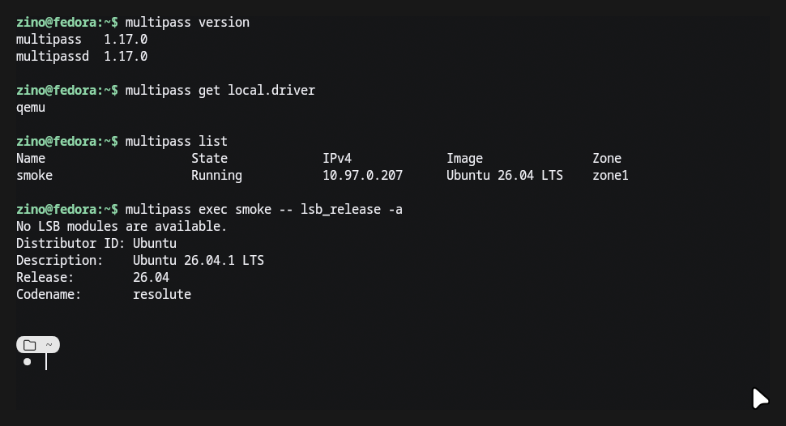
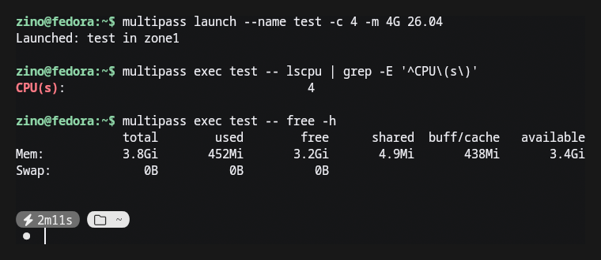

# KN01: Virtualisierung & erste automatisierte VM

**Host-System:** Fedora Linux 44, Intel Core i7-1355U (10 Kerne / 12 logische Prozessoren), 30 GiB RAM, 8 GiB Swap (zram)
**Multipass:** 1.17.0 · **Backend:** `qemu` (QEMU/KVM)

---

## A) Repository & Multipass-Test

### A1) Abgabe-Repository

- Repository: <https://github.com/zinoos/m346-abgabe> (öffentlich)
- Struktur: ein Ordner pro Kompetenz (`KN01/` … `KN09/`) mit je einer `README.md`, Screenshots in `KNxx/img/`, Code immer als eigene Datei.

### A2) Multipass installieren und Test-VM

Installation auf Fedora über Snap (`snapd` + `snap install multipass`).



Die Test-VM `smoke` lief und wurde danach mit `multipass delete --purge smoke` gelöscht.

### A3) Aufgetretene Probleme und Lösungen

Auf Fedora gab es zwei Probleme, die nicht in der A3-Tabelle stehen:

| Symptom | Ursache | Lösung |
|---|---|---|
| `launch` bricht mit «Timed out» ab, die VM hat keine IP-Adresse. | Die Firewall blockiert die DHCP-Anfrage der VM. | Bridges der Zone `trusted` zuweisen: `sudo firewall-cmd --permanent --zone=trusted --add-interface=mpqemubrzone1 …` und `sudo firewall-cmd --reload` |
| cloud-init kann keine Pakete installieren (`Network is unreachable`). | Docker blockiert die Weiterleitung ins Internet, auch für die VMs. | Ausnahme in Dockers Kette `DOCKER-USER`: `sudo iptables -I DOCKER-USER -i mpqemubrzone1 -j ACCEPT` (plus Regel für Antwortpakete) |

---

## B) Hypervisor-Experiment

### Host-Ressourcen


Der Host hat **12 logische Prozessoren** und **30 GiB RAM** (plus 8 GiB Swap).

### Backend und Vermutung

| Gruppenmitglied | Betriebssystem | Backend | Vermutung Typ 1 / Typ 2 |
|---|---|---|---|
| Zino Bonin | Fedora Linux 44 | `qemu` (QEMU mit KVM) | Typ 1 |
| ✏️ | ✏️ | ✏️ | ✏️ |

**Begründung:** KVM ist ein Teil des Linux-Kernels, der Kernel wird also selbst zum Hypervisor und die VMs laufen direkt auf der Hardware. Darum vermute ich Typ 1.

### VM mit expliziten Ressourcen (4 CPUs, 4 GB)



### CPU-Overcommitment: 16 vCPUs auf 12 logischen Prozessoren


Ergebnis: Die Zuweisung wird **akzeptiert**, die VM hat 16 CPUs, obwohl der Host nur 12 hat.

### RAM-Overcommitment: 38 GB auf 30 GiB Host-RAM


Ergebnis: Auch das wird **akzeptiert**, die VM zeigt 37 GiB, belegt aber nur ca. 700 MiB.

### Erklärung

**CPU:** Jede vCPU ist auf dem Host nur ein Thread, der in Zeitscheiben auf den echten Kernen läuft. Darum gehen auch 16 vCPUs, bei Volllast wird es einfach langsamer.

**RAM:** Der Host gibt den RAM erst, wenn die VM ihn wirklich braucht. Wird er knapp, lagert der Host in den Swap aus, und wenn auch der voll ist, beendet er Prozesse.

**Vermutung bestätigt?** Teilweise: Das Ergebnis passt zu KVM, aber auch andere Typ-1-Hypervisoren erlauben Overcommitment. Das Experiment beweist den Typ also nicht.

✏️ **Vergleich in der Gruppe:** Verhalten sich die Backends gleich?

Alle Test-VMs wurden danach gelöscht (`multipass delete --purge test cpu-test ram-test`).

---

## C) Erste automatisierte VM mit cloud-init

### C1) Basis-Konfiguration

Datei: [cloud-init-basis.yaml](cloud-init-basis.yaml)

```bash
multipass launch --name kn01 --cloud-init cloud-init-basis.yaml 26.04
```

**Pakete:** `tree` wurde installiert, `neofetch` **nicht**:


**Inhalt von `begruessung.txt`:**


**Welcher Teil stammt woher?** Die ersten zwei Zeilen kommen aus `write_files`. Die Zeile mit dem Datum hängt `runcmd` am Schluss an.

**cloud-init-Log** (`/var/log/cloud-init-output.log`):


**Fehleranalyse:** Laut Log wurde `neofetch` nicht gefunden, weil es das Paket in Ubuntu 26.04 nicht mehr gibt. Darum verwende ich in C2 den Nachfolger `fastfetch`.

Die VM `kn01` wurde danach gelöscht.

### C2) Eigene Konfiguration

Datei: **[cloud-init-kn01.yaml](cloud-init-kn01.yaml)** (jede Zeile kommentiert)

```yaml
#cloud-config
# Erste Zeile muss genau "#cloud-config" sein, sonst ignoriert cloud-init die Datei
package_update: true # Paketlisten (apt update) vor der Installation aktualisieren

packages: # Liste der Pakete, die beim ersten Boot installiert werden
  - fastfetch # Systeminfo-Anzeige; ersetzt neofetch, das es in Ubuntu 26.04 nicht mehr gibt
  - tree # Verzeichnisbaum anzeigen (aus der Basis-Konfiguration)
  - htop # zusätzliches Paket: interaktiver Prozess- und Ressourcenmonitor

users: # Liste der Benutzer, die beim ersten Boot erstellt werden
  - default # Standardbenutzer "ubuntu" behalten, sonst funktioniert "multipass shell" nicht mehr
  - name: zino # zusätzlicher Benutzer mit meinem Vornamen
    gecos: Zino Bonin # vollständiger Name (Beschreibungsfeld in /etc/passwd)
    groups: sudo # Mitglied der Gruppe sudo
    sudo: ALL=(ALL) NOPASSWD:ALL # sudo für alle Befehle ohne Passwortabfrage erlauben
    shell: /bin/bash # Bash als Login-Shell

write_files: # Dateien, die beim ersten Boot geschrieben werden
  - path: /home/ubuntu/begruessung.txt # Zielpfad der Datei (aus der Basis-Konfiguration)
    content: | # Dateiinhalt folgt als mehrzeiliger Block (Zeilenumbrüche bleiben erhalten)
      Diese Datei wurde von cloud-init erstellt.
      Niemand hat sie von Hand angelegt.
  - path: /etc/motd # eigene Datei: Begrüssung, die bei jedem Login angezeigt wird
    permissions: "0644" # Lesbar für alle, schreibbar nur für root
    content: | # Inhalt der Login-Nachricht
      ==============================================
       M346 KN01 - VM von Zino Bonin
       Automatisch eingerichtet mit cloud-init
      ==============================================

runcmd: # Befehle, die einmalig am Ende des ersten Boots als root ausgeführt werden
  - echo "Installation abgeschlossen am $(date)" >> /home/ubuntu/begruessung.txt # Datum an die Begrüssungsdatei anhängen
  - mkdir -p /home/zino/projekte # eigener Befehl: Projektordner für meinen Benutzer anlegen
  - echo "Erstellt von cloud-init am $(date)" > /home/zino/projekte/info.txt # Nachweisdatei in den neuen Ordner schreiben
  - chown -R zino:zino /home/zino/projekte # Ordner dem Benutzer zino übergeben (runcmd läuft als root)
```

```bash
multipass launch --name kn01v2 --cloud-init cloud-init-kn01.yaml 26.04
```

`cloud-init status` meldet diesmal `done` (keine Fehler).

**Nachweis 1 – Benutzer `zino`** und **Nachweis 2 – Pakete**:


**Nachweis 3 – eigene Datei** `/etc/motd` und **Nachweis 4 – `runcmd`-Befehl** (`/home/zino/projekte/info.txt`):


---

## D) Reflexion: von Hand vs. automatisiert

Zuerst eine VM ohne cloud-init (`multipass launch --name manuell 26.04`), danach von Hand derselbe Zustand wie bei `kn01v2`:

```bash
sudo apt-get update
sudo apt-get install -y fastfetch tree htop
sudo useradd -m -s /bin/bash -c "Zino Bonin" -G sudo zino
echo "zino ALL=(ALL) NOPASSWD:ALL" | sudo tee /etc/sudoers.d/90-zino && sudo chmod 440 /etc/sudoers.d/90-zino
printf "Diese Datei wurde von cloud-init erstellt.\nNiemand hat sie von Hand angelegt.\n" > /home/ubuntu/begruessung.txt
echo "Installation abgeschlossen am $(date)" >> /home/ubuntu/begruessung.txt
sudo nano /etc/motd        # Begrüssungstext von Hand eintippen
sudo mkdir -p /home/zino/projekte
echo "Erstellt am $(date)" | sudo tee /home/zino/projekte/info.txt
sudo chown -R zino:zino /home/zino/projekte
```

Danach beide VMs gelöscht und die automatisierte VM mit einem einzigen Befehl neu erstellt:

```bash
multipass launch --name kn01v2 --cloud-init cloud-init-kn01.yaml 26.04
```

| Variante | Aktive Arbeitszeit | Wartezeit (Installation) |
|---|---|---|
| Von Hand (`manuell`) | ca. 1,5 min (mit fertiger Befehlsliste) | ca. 2 min VM-Start + 46 s Paketinstallation |
| Automatisiert (`kn01v2`, ein Befehl) | ca. 10 s (ein Befehl tippen) | 61 s, danach `cloud-init status: done` |

**Fehlversuch:** Beim ersten Versuch schlug die Paketinstallation fehl, weil die VM kein Internet hatte. Ich habe es erst beim Prüfen bemerkt.

**Reflexion:**
Von Hand macht man schnell Fehler, und bei mir ist ein Befehl unbemerkt fehlgeschlagen. Mit cloud-init läuft jedes Mal genau dasselbe ab. Für 10 VMs müsste ich von Hand alles zehnmal machen. Mit cloud-init ist es zehnmal derselbe Befehl. Die Grenze ist, dass cloud-init nur beim ersten Start läuft.
