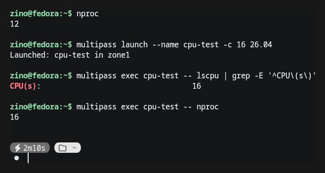
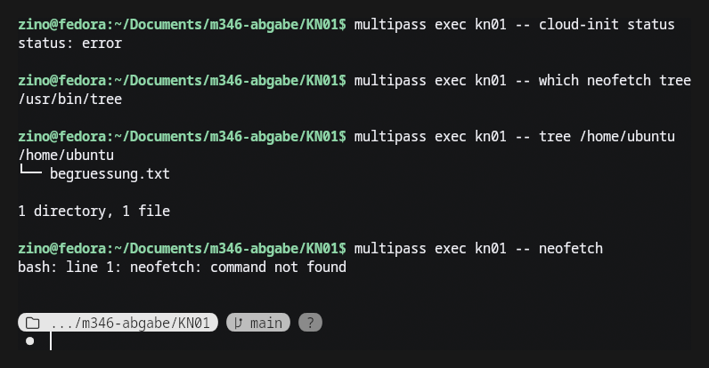
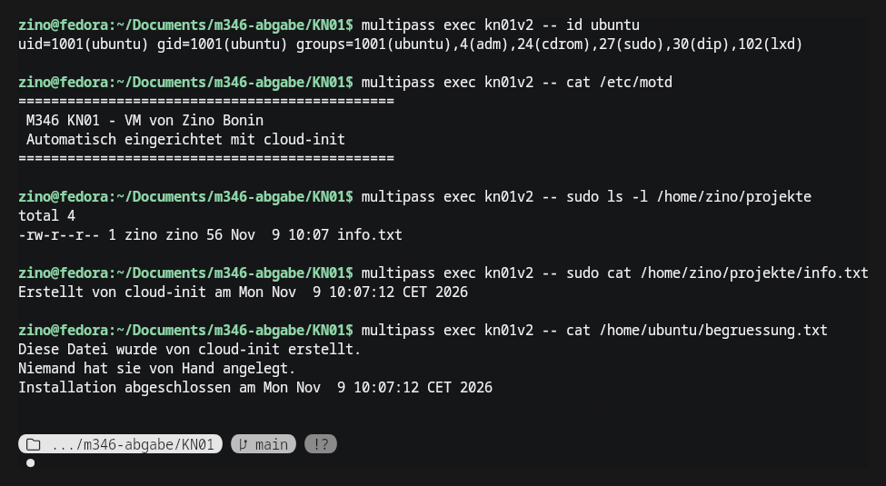

# KN01: Virtualisierung & erste automatisierte VM

**Host-System:** Fedora Linux 44, Intel Core i7-1355U (10 Kerne / 12 logische Prozessoren), 30 GiB RAM, 8 GiB Swap (zram)
**Multipass:** 1.17.0 · **Backend:** `qemu` (QEMU/KVM)

---

## A) Repository & Multipass-Test

### A1) Abgabe-Repository

- Repository: <https://github.com/zinoos/m346-abgabe> (privat) · ✏️ Lehrperson mit Leserechten berechtigen
- Struktur: ein Ordner pro Kompetenz (`KN01/` … `KN09/`) mit je einer `README.md`, Screenshots in `KNxx/img/`, Code immer als eigene Datei.

### A2) Multipass installieren und Test-VM

Installation auf Fedora über Snap (`snapd` + `snap install multipass`).


Die Test-VM `smoke` (1 CPU, 1 GB RAM, 5 GB Disk, Ubuntu 26.04) lief und wurde danach mit `multipass delete --purge smoke` wieder gelöscht.

### A3) Aufgetretene Probleme und Lösungen

Auf Fedora lief Multipass nicht auf Anhieb. Zwei Probleme, beide nicht in der A3-Tabelle (die ist auf Windows ausgerichtet):

| Symptom | Ursache | Lösung |
|---|---|---|
| `launch` hängt bei «Starting» und bricht nach 15 min mit «Timed out waiting for instance launch» ab. VM hat keine IPv4-Adresse. | Die Fedora-Firewall (firewalld) ordnet die Multipass-Bridge `mpqemubrzone1` der Standardzone zu, die nur Ports ab 1025 erlaubt. Die DHCP-Anfrage der VM (UDP-Port 67) wird blockiert. | Bridges der Zone `trusted` zuweisen: `sudo firewall-cmd --permanent --zone=trusted --add-interface=mpqemubrzone1 …` und `sudo firewall-cmd --reload` |
| VM startet, aber cloud-init kann keine Pakete installieren (`Network is unreachable` im Log). Gateway und DNS funktionieren, Internet nicht. | Docker ist ebenfalls installiert und setzt die Forwarding-Policy des Kernels auf `DROP`. Damit wird auch der Verkehr der Multipass-VMs ins Internet verworfen. | Ausnahme in Dockers Kette `DOCKER-USER`: `sudo iptables -I DOCKER-USER -i mpqemubrzone1 -j ACCEPT` (plus Regel für Antwortpakete) |

---

## B) Hypervisor-Experiment

### Host-Ressourcen


Der Host hat **12 logische Prozessoren** (10 physische Kerne, davon 2 mit Hyper-Threading) und **30 GiB RAM** plus 8 GiB Swap.

### Backend und Vermutung

| Gruppenmitglied | Betriebssystem | Backend | Vermutung Typ 1 / Typ 2 |
|---|---|---|---|
| Zino Bonin | Fedora Linux 44 | `qemu` (QEMU mit KVM) | Typ 1 |
| ✏️ | ✏️ | ✏️ | ✏️ |

**Begründung der Vermutung:** Auf Linux verwendet Multipass QEMU zusammen mit **KVM**. KVM ist ein Modul direkt im Linux-Kernel. Sobald es geladen ist, wird der Kernel selbst zum Hypervisor: Die VMs laufen mit Hilfe der Virtualisierungsfunktionen der CPU (Intel VT-x) direkt auf der Hardware, und der Kernel verteilt CPU-Zeit und RAM an sie wie an normale Prozesse. QEMU emuliert nur die Geräte (Netzwerkkarte, Disk), die eigentliche Ausführung macht KVM. Darum vermute ich **Typ 1**. Es gibt aber ein Argument für Typ 2: Auf meinem Laptop läuft ja ein ganz normales Desktop-Betriebssystem, und die VMs werden als Programme darin gestartet. KVM ist deshalb eine Art Mischform, wird aber meistens als Typ 1 eingeordnet, weil der Hypervisor Teil des Kernels ist und nicht ein Programm über dem Betriebssystem.

### VM mit expliziten Ressourcen (4 CPUs, 4 GB)


### CPU-Overcommitment: 16 vCPUs auf 12 logischen Prozessoren



Ergebnis: Multipass/QEMU **akzeptiert** die Zuweisung. Die VM `cpu-test` meldet 16 CPUs (`lscpu`, `nproc`), obwohl der Host nur 12 logische Prozessoren hat.

### RAM-Overcommitment: 38 GB auf 30 GiB Host-RAM


Ergebnis: Auch das wird **akzeptiert**. `free -h` in der VM `ram-test` zeigt 37 GiB, also mehr als der Host physisch hat. Belegt sind in der VM nach dem Start nur rund 700 MiB.

### Erklärung

**CPU (Zeitscheiben):** Eine virtuelle CPU ist für den Host nichts anderes als ein Thread des QEMU-Prozesses. Der Scheduler des Host-Kernels verteilt die 12 logischen Prozessoren in kurzen Zeitscheiben (Millisekunden) auf alle Threads, die gerade rechnen wollen. 16 vCPUs auf 12 logischen Prozessoren gehen also problemlos, sie müssen sich die echten Kerne einfach teilen. Weil eine VM fast nie alle vCPUs gleichzeitig voll auslastet, merkt man davon meist nichts. Erst wenn alle 16 vCPUs gleichzeitig unter Volllast stehen, bekommt jede nur noch etwa 12/16 der Rechenzeit, und die VM wird langsamer.

**RAM (bedarfsgerechte Zuteilung und Swap):** Die 38 GB werden beim Start nicht wirklich reserviert. QEMU bekommt vom Host nur virtuellen Adressraum, echte RAM-Seiten werden erst zugeteilt, wenn die VM sie tatsächlich beschreibt. Darum belegt `ram-test` nach dem Start nur rund 700 MiB, obwohl sie 37 GiB «sieht». Würde die VM den Speicher wirklich füllen, würde der Host zuerst wenig benutzte Seiten in den Swap auslagern (bei mir 8 GiB zram). Das macht alles stark langsamer. Wenn auch der Swap voll ist (30 GiB RAM + 8 GiB Swap ≈ 38 GiB, also genau an der Grenze), beendet der OOM-Killer des Host-Kernels Prozesse, im schlimmsten Fall die VM selbst.

**Hat sich die Vermutung bestätigt?** Teilweise. Das Ergebnis passt zu KVM: Der Linux-Kernel behandelt die VMs wie normale Prozesse und verteilt CPU und RAM mit denselben Mechanismen (Scheduler, Speicherverwaltung, Swap), und genau das ermöglicht das Overcommitment. Allein mit diesem Experiment lässt sich der Typ aber nicht eindeutig bestimmen, denn auch klassische Typ-1-Hypervisoren in Rechenzentren (z. B. VMware ESXi) erlauben Overcommitment. Das ist dort sogar gewollt, weil man so mehr VMs auf einen Server bringt. Overcommitment ist also eine Eigenschaft der Ressourcenverwaltung, nicht des Hypervisor-Typs. Es funktioniert nur gut, solange nicht alle VMs gleichzeitig ihre vollen Ressourcen brauchen.

✏️ **Vergleich in der Gruppe:** Verhalten sich die Backends gleich?

Alle Test-VMs wurden danach gelöscht (`multipass delete --purge test cpu-test ram-test`).

---

## C) Erste automatisierte VM mit cloud-init

### C1) Basis-Konfiguration

Datei: [cloud-init-basis.yaml](cloud-init-basis.yaml)

```bash
multipass launch --name kn01 --cloud-init cloud-init-basis.yaml 26.04
```

**Pakete:** `tree` wurde installiert, `neofetch` **nicht**:



**Inhalt von `begruessung.txt`:**


**Welcher Teil stammt woher?** Die ersten zwei Zeilen («Diese Datei wurde von cloud-init erstellt.» und «Niemand hat sie von Hand angelegt.») stammen aus `write_files`: Dieser Block legt die Datei mit genau diesem festen Inhalt an. Die letzte Zeile «Installation abgeschlossen am …» stammt aus `runcmd`: Der Befehl `echo … >> /home/ubuntu/begruessung.txt` hängt sie mit `>>` an die bestehende Datei an. `$(date)` wird dabei erst beim Ausführen ersetzt, darum steht dort der Zeitpunkt der Installation. Das funktioniert nur, weil `write_files` früh im Boot läuft und `runcmd` erst ganz am Schluss.

**cloud-init-Log** (`/var/log/cloud-init-output.log`):


**Fehleranalyse mit dem Log:** `cloud-init status` meldet `error`. Das Log zeigt `Failure when attempting to install packages: ['neofetch', …]`, das Detail-Log `/var/log/cloud-init.log` den Grund: `The following packages were not found by APT … ['neofetch']`. Das Paket `neofetch` gibt es in Ubuntu 26.04 nicht mehr (das Projekt wurde eingestellt). Der Nachfolger ist `fastfetch`. Darum verwende ich in C2 `fastfetch`.

Die VM `kn01` wurde danach gelöscht.

### C2) Eigene Konfiguration

Datei: **[cloud-init-kn01.yaml](cloud-init-kn01.yaml)** (jede Zeile kommentiert)

```yaml
#cloud-config
# Erste Zeile muss genau "#cloud-config" sein, sonst ignoriert cloud-init die Datei
package_update: true # Paketlisten (apt update) vor der Installation aktualisieren

packages: # Liste der Pakete, die beim ersten Boot installiert werden
  - fastfetch # Systeminfo-Anzeige; ersetzt neofetch, das es in Ubuntu 26.04 nicht mehr gibt
  - tree # Verzeichnisbaum anzeigen (aus der Basis-Konfiguration)
  - htop # zusätzliches Paket: interaktiver Prozess- und Ressourcenmonitor

users: # Liste der Benutzer, die beim ersten Boot erstellt werden
  - default # Standardbenutzer "ubuntu" behalten, sonst funktioniert "multipass shell" nicht mehr
  - name: zino # zusätzlicher Benutzer mit meinem Vornamen
    gecos: Zino Bonin # vollständiger Name (Beschreibungsfeld in /etc/passwd)
    groups: sudo # Mitglied der Gruppe sudo
    sudo: ALL=(ALL) NOPASSWD:ALL # sudo für alle Befehle ohne Passwortabfrage erlauben
    shell: /bin/bash # Bash als Login-Shell

write_files: # Dateien, die beim ersten Boot geschrieben werden
  - path: /home/ubuntu/begruessung.txt # Zielpfad der Datei (aus der Basis-Konfiguration)
    content: | # Dateiinhalt folgt als mehrzeiliger Block (Zeilenumbrüche bleiben erhalten)
      Diese Datei wurde von cloud-init erstellt.
      Niemand hat sie von Hand angelegt.
  - path: /etc/motd # eigene Datei: Begrüssung, die bei jedem Login angezeigt wird
    permissions: "0644" # Lesbar für alle, schreibbar nur für root
    content: | # Inhalt der Login-Nachricht
      ==============================================
       M346 KN01 - VM von Zino Bonin
       Automatisch eingerichtet mit cloud-init
      ==============================================

runcmd: # Befehle, die einmalig am Ende des ersten Boots als root ausgeführt werden
  - echo "Installation abgeschlossen am $(date)" >> /home/ubuntu/begruessung.txt # Datum an die Begrüssungsdatei anhängen
  - mkdir -p /home/zino/projekte # eigener Befehl: Projektordner für meinen Benutzer anlegen
  - echo "Erstellt von cloud-init am $(date)" > /home/zino/projekte/info.txt # Nachweisdatei in den neuen Ordner schreiben
  - chown -R zino:zino /home/zino/projekte # Ordner dem Benutzer zino übergeben (runcmd läuft als root)
```

```bash
multipass launch --name kn01v2 --cloud-init cloud-init-kn01.yaml 26.04
```

`cloud-init status` meldet diesmal `done` (keine Fehler).

**Nachweis 1 – Benutzer `zino`** (Bash als Shell, Gruppe `sudo`, sudo funktioniert) **und Nachweis 2 – Pakete** (`htop` zusätzlich, `fastfetch`, `tree`):


**Nachweis 3 – eigene Datei** `/etc/motd` und **Nachweis 4 – eigener `runcmd`-Befehl** (`/home/zino/projekte/info.txt`, gehört `zino`). Der Standardbenutzer `ubuntu` existiert weiterhin (`default` in der `users`-Liste):



---

## D) Reflexion: von Hand vs. automatisiert

Zuerst eine VM ohne cloud-init (`multipass launch --name manuell 26.04`), danach von Hand derselbe Zustand wie bei `kn01v2`:

```bash
sudo apt-get update
sudo apt-get install -y fastfetch tree htop
sudo useradd -m -s /bin/bash -c "Zino Bonin" -G sudo zino
echo "zino ALL=(ALL) NOPASSWD:ALL" | sudo tee /etc/sudoers.d/90-zino && sudo chmod 440 /etc/sudoers.d/90-zino
printf "Diese Datei wurde von cloud-init erstellt.\nNiemand hat sie von Hand angelegt.\n" > /home/ubuntu/begruessung.txt
echo "Installation abgeschlossen am $(date)" >> /home/ubuntu/begruessung.txt
sudo nano /etc/motd        # Begrüssungstext von Hand eintippen
sudo mkdir -p /home/zino/projekte
echo "Erstellt am $(date)" | sudo tee /home/zino/projekte/info.txt
sudo chown -R zino:zino /home/zino/projekte
```

Danach beide VMs gelöscht und die automatisierte VM mit einem einzigen Befehl neu erstellt:

```bash
multipass launch --name kn01v2 --cloud-init cloud-init-kn01.yaml 26.04
```

| Variante | Aktive Arbeitszeit | Wartezeit (Installation) |
|---|---|---|
| Von Hand (`manuell`) | ca. 1,5 min für die reinen Befehle, mit fertig vorbereiteter Befehlsliste und einem Fehlversuch (siehe unten). Ohne Vorlage, mit Nachschlagen und Tippen, realistisch eher 10–15 min. | ca. 2 min VM-Start + 46 s Paketinstallation |
| Automatisiert (`kn01v2`, ein Befehl) | ca. 10 s (ein Befehl tippen) | 61 s, danach `cloud-init status: done` |

**Fehlversuch bei der Handarbeit:** Beim ersten Durchgang ist die Paketinstallation fehlgeschlagen (`Unable to locate package fastfetch`), weil die VM wegen der Docker-Regel aus A3 kein Internet hatte. Die übrigen Befehle liefen trotzdem weiter, und die VM sah auf den ersten Blick fertig aus. Aufgefallen ist es erst beim Überprüfen. Nach dem Reparieren der Weiterleitung musste ich `apt-get update` und `install` noch einmal ausführen.

**Reflexion:**
Von Hand passieren leicht Fehler, die man nicht sofort merkt: ein Tippfehler im Benutzernamen, eine vergessene Gruppe, falsche Dateirechte oder wie bei mir ein fehlgeschlagener Befehl, nach dem man einfach weitermacht. Bei cloud-init steht die Konfiguration einmal geprüft in einer Datei, sie läuft jedes Mal gleich ab, und ob etwas schiefging, sieht man zentral mit `cloud-init status` und im Log `/var/log/cloud-init-output.log`. Brauche ich morgen 10 solche VMs, muss ich von Hand zehnmal dieselben Schritte wiederholen. Das kostet Stunden, und jede VM wird ein bisschen anders. Mit cloud-init ist es zehnmal derselbe Befehl (oder eine Schleife), die VMs sind garantiert identisch, und die Datei ist in Git versioniert und dokumentiert sich selbst. Grenzen hat cloud-init trotzdem: Es läuft nur beim ersten Boot, Änderungen an einer bestehenden VM gehen damit also nicht, man muss sie neu erstellen. Fehler findet man erst nach dem Start im Log, und für grössere Setups mit vielen VMs, Netzwerken oder späteren Änderungen braucht es zusätzliche Werkzeuge wie OpenTofu oder Ansible.
