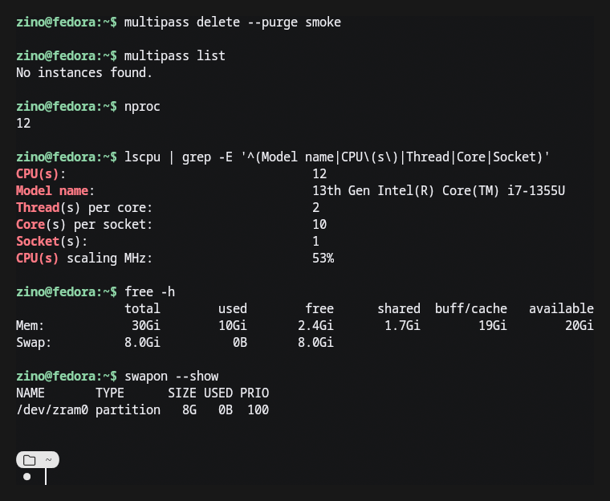
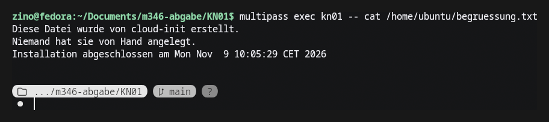

# KN01: Virtualisierung & erste automatisierte VM

**Host-System:** Fedora Linux 44, Intel Core i7-1355U (10 Kerne / 12 logische Prozessoren), 30 GiB RAM, 8 GiB Swap (zram)
**Multipass:** 1.17.0 · **Backend:** `qemu` (QEMU/KVM)

---

## A) Repository & Multipass-Test

### A1) Abgabe-Repository

- Repository: <https://github.com/zinoos/m346-abgabe> (privat) · ✏️ Lehrperson mit Leserechten berechtigen
- Struktur: ein Ordner pro Kompetenz (`KN01/` … `KN09/`) mit je einer `README.md`, Screenshots in `KNxx/img/`, Code immer als eigene Datei.

### A2) Multipass installieren und Test-VM

Installation auf Fedora über Snap (`snapd` + `snap install multipass`).


Die Test-VM `smoke` (1 CPU, 1 GB RAM, 5 GB Disk, Ubuntu 26.04) lief und wurde danach mit `multipass delete --purge smoke` wieder gelöscht.

### A3) Aufgetretene Probleme und Lösungen

Auf Fedora lief Multipass nicht auf Anhieb. Zwei Probleme, beide nicht in der A3-Tabelle (die ist auf Windows ausgerichtet):

| Symptom | Ursache | Lösung |
|---|---|---|
| `launch` hängt bei «Starting» und bricht nach 15 min mit «Timed out waiting for instance launch» ab. VM hat keine IPv4-Adresse. | Die Fedora-Firewall (firewalld) ordnet die Multipass-Bridge `mpqemubrzone1` der Standardzone zu, die nur Ports ab 1025 erlaubt. Die DHCP-Anfrage der VM (UDP-Port 67) wird blockiert. | Bridges der Zone `trusted` zuweisen: `sudo firewall-cmd --permanent --zone=trusted --add-interface=mpqemubrzone1 …` und `sudo firewall-cmd --reload` |
| VM startet, aber cloud-init kann keine Pakete installieren (`Network is unreachable` im Log). Gateway und DNS funktionieren, Internet nicht. | Docker ist ebenfalls installiert und setzt die Forwarding-Policy des Kernels auf `DROP`. Damit wird auch der Verkehr der Multipass-VMs ins Internet verworfen. | Ausnahme in Dockers Kette `DOCKER-USER`: `sudo iptables -I DOCKER-USER -i mpqemubrzone1 -j ACCEPT` (plus Regel für Antwortpakete) |

---

## B) Hypervisor-Experiment

### Host-Ressourcen



Der Host hat **12 logische Prozessoren** (10 physische Kerne, davon 2 mit Hyper-Threading) und **30 GiB RAM** plus 8 GiB Swap.

### Backend und Vermutung

| Gruppenmitglied | Betriebssystem | Backend | Vermutung Typ 1 / Typ 2 |
|---|---|---|---|
| Zino Bonin | Fedora Linux 44 | `qemu` (QEMU mit KVM) | Typ 1 |
| ✏️ | ✏️ | ✏️ | ✏️ |

**Begründung der Vermutung:** Ich vermute **Typ 1**. Multipass nutzt auf Linux QEMU mit KVM. KVM ist ein Teil des Linux-Kernels. Der Kernel wird damit selbst zum Hypervisor. Die VMs laufen direkt auf der CPU (mit Intel VT-x). QEMU stellt nur die virtuellen Geräte bereit, z. B. Netzwerk und Disk. Ein Argument für Typ 2 gibt es auch: Auf meinem Laptop läuft ein normales Betriebssystem, und die VMs sind Programme darin. KVM ist darum eine Mischform. Meistens zählt man es aber zu Typ 1.

### VM mit expliziten Ressourcen (4 CPUs, 4 GB)


### CPU-Overcommitment: 16 vCPUs auf 12 logischen Prozessoren


Ergebnis: Multipass/QEMU **akzeptiert** die Zuweisung. Die VM `cpu-test` meldet 16 CPUs (`lscpu`, `nproc`), obwohl der Host nur 12 logische Prozessoren hat.

### RAM-Overcommitment: 38 GB auf 30 GiB Host-RAM


Ergebnis: Auch das wird **akzeptiert**. `free -h` in der VM `ram-test` zeigt 37 GiB, also mehr als der Host physisch hat. Belegt sind in der VM nach dem Start nur rund 700 MiB.

### Erklärung

**CPU (Zeitscheiben):** Eine virtuelle CPU ist für den Host nur ein Thread. Der Host teilt seine 12 Prozessoren in kurze Zeitscheiben auf. Jeder Thread kommt der Reihe nach dran. Darum gehen auch 16 vCPUs. Sie teilen sich einfach die echten Kerne. Solange die VM nicht alle CPUs gleichzeitig voll braucht, merkt man nichts. Bei Volllast wird die VM langsamer.

**RAM (Zuteilung bei Bedarf und Swap):** Die 38 GB werden beim Start nicht wirklich belegt. Der Host gibt RAM erst, wenn die VM ihn braucht. Darum belegt `ram-test` nur ca. 700 MiB. Braucht die VM mehr, als der Host hat, lagert der Host Daten in den Swap aus. Das ist viel langsamer. Ist auch der Swap voll, beendet der Host Prozesse (OOM-Killer). Im schlimmsten Fall ist das die VM.

**Hat sich die Vermutung bestätigt?** Teilweise. Das Ergebnis passt zu KVM: Der Kernel verwaltet die VMs wie normale Prozesse. Darum ist Overcommitment möglich. Das Experiment beweist den Typ aber nicht. Auch echte Typ-1-Hypervisoren wie VMware ESXi erlauben Overcommitment. Overcommitment funktioniert gut, solange nicht alle VMs gleichzeitig alles brauchen.

✏️ **Vergleich in der Gruppe:** Verhalten sich die Backends gleich?

Alle Test-VMs wurden danach gelöscht (`multipass delete --purge test cpu-test ram-test`).

---

## C) Erste automatisierte VM mit cloud-init

### C1) Basis-Konfiguration

Datei: [cloud-init-basis.yaml](cloud-init-basis.yaml)

```bash
multipass launch --name kn01 --cloud-init cloud-init-basis.yaml 26.04
```

**Pakete:** `tree` wurde installiert, `neofetch` **nicht**:


**Inhalt von `begruessung.txt`:**



**Welcher Teil stammt woher?** Die ersten zwei Zeilen kommen aus `write_files`. Dieser Block erstellt die Datei mit festem Text. Die letzte Zeile «Installation abgeschlossen am …» kommt aus `runcmd`. Der Befehl hängt sie mit `>>` hinten an. `$(date)` setzt dabei das aktuelle Datum ein.

**cloud-init-Log** (`/var/log/cloud-init-output.log`):


**Fehleranalyse mit dem Log:** `cloud-init status` meldet `error`. Im Log steht `Failure when attempting to install packages: ['neofetch', …]`. Das Detail-Log `/var/log/cloud-init.log` zeigt den Grund: `The following packages were not found by APT … ['neofetch']`. `neofetch` gibt es in Ubuntu 26.04 nicht mehr. Der Nachfolger heisst `fastfetch`. Darum nehme ich in C2 `fastfetch`.

Die VM `kn01` wurde danach gelöscht.

### C2) Eigene Konfiguration

Datei: **[cloud-init-kn01.yaml](cloud-init-kn01.yaml)** (jede Zeile kommentiert)

```yaml
#cloud-config
# Erste Zeile muss genau "#cloud-config" sein, sonst ignoriert cloud-init die Datei
package_update: true # Paketlisten (apt update) vor der Installation aktualisieren

packages: # Liste der Pakete, die beim ersten Boot installiert werden
  - fastfetch # Systeminfo-Anzeige; ersetzt neofetch, das es in Ubuntu 26.04 nicht mehr gibt
  - tree # Verzeichnisbaum anzeigen (aus der Basis-Konfiguration)
  - htop # zusätzliches Paket: interaktiver Prozess- und Ressourcenmonitor

users: # Liste der Benutzer, die beim ersten Boot erstellt werden
  - default # Standardbenutzer "ubuntu" behalten, sonst funktioniert "multipass shell" nicht mehr
  - name: zino # zusätzlicher Benutzer mit meinem Vornamen
    gecos: Zino Bonin # vollständiger Name (Beschreibungsfeld in /etc/passwd)
    groups: sudo # Mitglied der Gruppe sudo
    sudo: ALL=(ALL) NOPASSWD:ALL # sudo für alle Befehle ohne Passwortabfrage erlauben
    shell: /bin/bash # Bash als Login-Shell

write_files: # Dateien, die beim ersten Boot geschrieben werden
  - path: /home/ubuntu/begruessung.txt # Zielpfad der Datei (aus der Basis-Konfiguration)
    content: | # Dateiinhalt folgt als mehrzeiliger Block (Zeilenumbrüche bleiben erhalten)
      Diese Datei wurde von cloud-init erstellt.
      Niemand hat sie von Hand angelegt.
  - path: /etc/motd # eigene Datei: Begrüssung, die bei jedem Login angezeigt wird
    permissions: "0644" # Lesbar für alle, schreibbar nur für root
    content: | # Inhalt der Login-Nachricht
      ==============================================
       M346 KN01 - VM von Zino Bonin
       Automatisch eingerichtet mit cloud-init
      ==============================================

runcmd: # Befehle, die einmalig am Ende des ersten Boots als root ausgeführt werden
  - echo "Installation abgeschlossen am $(date)" >> /home/ubuntu/begruessung.txt # Datum an die Begrüssungsdatei anhängen
  - mkdir -p /home/zino/projekte # eigener Befehl: Projektordner für meinen Benutzer anlegen
  - echo "Erstellt von cloud-init am $(date)" > /home/zino/projekte/info.txt # Nachweisdatei in den neuen Ordner schreiben
  - chown -R zino:zino /home/zino/projekte # Ordner dem Benutzer zino übergeben (runcmd läuft als root)
```

```bash
multipass launch --name kn01v2 --cloud-init cloud-init-kn01.yaml 26.04
```

`cloud-init status` meldet diesmal `done` (keine Fehler).

**Nachweis 1 – Benutzer `zino`** (Bash als Shell, Gruppe `sudo`, sudo funktioniert) **und Nachweis 2 – Pakete** (`htop` zusätzlich, `fastfetch`, `tree`):


**Nachweis 3 – eigene Datei** `/etc/motd` und **Nachweis 4 – eigener `runcmd`-Befehl** (`/home/zino/projekte/info.txt`, gehört `zino`). Der Standardbenutzer `ubuntu` existiert weiterhin (`default` in der `users`-Liste):


---

## D) Reflexion: von Hand vs. automatisiert

Zuerst eine VM ohne cloud-init (`multipass launch --name manuell 26.04`), danach von Hand derselbe Zustand wie bei `kn01v2`:

```bash
sudo apt-get update
sudo apt-get install -y fastfetch tree htop
sudo useradd -m -s /bin/bash -c "Zino Bonin" -G sudo zino
echo "zino ALL=(ALL) NOPASSWD:ALL" | sudo tee /etc/sudoers.d/90-zino && sudo chmod 440 /etc/sudoers.d/90-zino
printf "Diese Datei wurde von cloud-init erstellt.\nNiemand hat sie von Hand angelegt.\n" > /home/ubuntu/begruessung.txt
echo "Installation abgeschlossen am $(date)" >> /home/ubuntu/begruessung.txt
sudo nano /etc/motd        # Begrüssungstext von Hand eintippen
sudo mkdir -p /home/zino/projekte
echo "Erstellt am $(date)" | sudo tee /home/zino/projekte/info.txt
sudo chown -R zino:zino /home/zino/projekte
```

Danach beide VMs gelöscht und die automatisierte VM mit einem einzigen Befehl neu erstellt:

```bash
multipass launch --name kn01v2 --cloud-init cloud-init-kn01.yaml 26.04
```

| Variante | Aktive Arbeitszeit | Wartezeit (Installation) |
|---|---|---|
| Von Hand (`manuell`) | ca. 1,5 min mit fertiger Befehlsliste (plus ein Fehlversuch, siehe unten). Ohne Vorlage eher 10–15 min. | ca. 2 min VM-Start + 46 s Paketinstallation |
| Automatisiert (`kn01v2`, ein Befehl) | ca. 10 s (ein Befehl tippen) | 61 s, danach `cloud-init status: done` |

**Fehlversuch bei der Handarbeit:** Beim ersten Versuch hat die Paketinstallation nicht geklappt (`Unable to locate package fastfetch`). Die VM hatte kein Internet, wegen der Docker-Regel aus A3. Die anderen Befehle liefen trotzdem weiter. Ich habe den Fehler erst beim Prüfen bemerkt. Danach musste ich die Pakete nochmals installieren.

**Reflexion:**
Von Hand macht man schnell Fehler. Zum Beispiel einen Tippfehler oder einen vergessenen Schritt. Bei mir ist ein Befehl fehlgeschlagen, und ich habe es zuerst nicht gemerkt. Mit cloud-init läuft jedes Mal genau dasselbe ab. Für 10 VMs müsste ich von Hand alles zehnmal machen. Mit cloud-init ist es zehnmal derselbe Befehl, und alle VMs sind gleich. Eine Grenze ist: cloud-init läuft nur beim ersten Start. Für Änderungen muss ich die VM neu erstellen.
